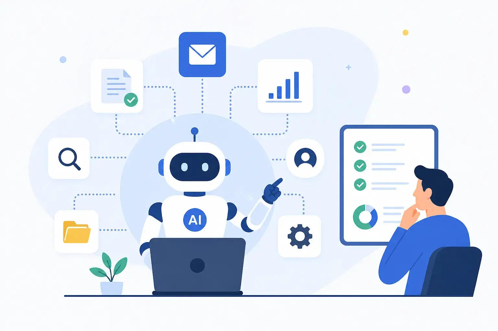
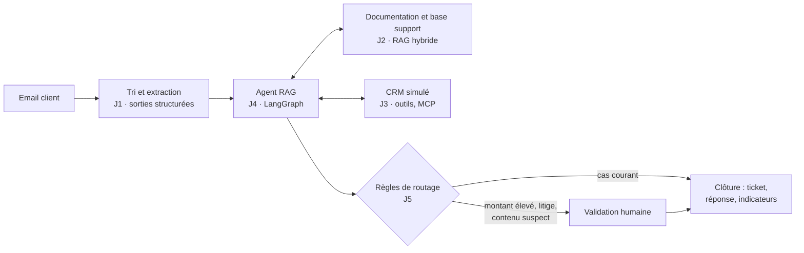

<p align="center">
  
</p>

<h1 align="center">Autonomous AI Agents & RPA 2.0</h1>

<p align="center">
  <strong>De la maîtrise des LLM à l'industrialisation des processus intelligents</strong><br>
  Formation de 5 jours, en français · ateliers pratiques chaque jour · un projet fil rouge du premier au dernier jour
</p>

<p align="center">
  
  
  
  
  
  
  
</p>

<p align="center">
  <a href="#le-parcours">Parcours</a> ·
  <a href="#projet-fil-rouge">Projet fil rouge</a> ·
  <a href="#démarrage-rapide">Démarrage rapide</a> ·
  <a href="#configuration">Configuration</a> ·
  <a href="#modèles-et-fournisseurs">Modèles</a> ·
  <a href="#stack-technique">Stack technique</a>
</p>

---

## À propos

La RPA classique exécute des règles ; la **RPA 2.0** y ajoute la compréhension, la recherche d'information et la décision assistée par l'IA générative, à condition d'être mesurée, sécurisée et gouvernée. Cette formation suit un parcours progressif : comprendre les LLM avant de les augmenter par le RAG, maîtriser le RAG avant de l'intégrer à des agents, concevoir des agents avant de les industrialiser dans un workflow supervisé.

```
LLM  ──▶  RAG  ──▶  Agents IA  ──▶  Agents RAG  ──▶  RPA 2.0
 J1        J2         J3             J4              J5
```

Le dépôt réunit tout le matériel de la formation :

- **5 supports de cours** (223 pages au format PDF) ;
- **18 ateliers** : notebooks Jupyter complets et commentés, et leur version exécutée de référence ;
- des **données synthétiques** cohérentes d'un jour à l'autre : corpus documentaire, CRM simulé, emails, golden sets d'évaluation ;
- une **application web** (backend FastAPI, frontend Next.js), un **workflow n8n** importable et son équivalent en Python ;
- les supports de **restitution** et de **clôture** (grille d'évaluation, quiz final, plan d'action à 90 jours).

## Objectifs pédagogiques

À l'issue de la formation, les participants savent :

1. expliquer le fonctionnement et les limites des LLM, et choisir un modèle selon la qualité, le coût, la latence et la confidentialité ;
2. concevoir des prompts robustes et produire des sorties structurées et vérifiables ;
3. implémenter un pipeline RAG sur un corpus métier et en mesurer la qualité ;
4. développer un agent outillé (function calling, MCP), observable et doté de garde-fous ;
5. construire un agent RAG multi-sources qui cite ses sources, puis l'évaluer et l'attaquer (red teaming) ;
6. identifier, prioriser et chiffrer les processus éligibles à la RPA 2.0 ;
7. intégrer un agent dans un workflow de bout en bout, avec validation humaine et indicateurs ;
8. appliquer les exigences de sécurité et de conformité (nLPD, RGPD, AI Act) à un projet d'automatisation intelligente.

**Public :** développeurs, data scientists, ingénieurs data et ML, architectes SI, consultants techniques et responsables de l'automatisation. Les profils moins techniques (chefs de projet IA, consultants en transformation) travaillent en binôme avec un développeur.

**Prérequis :** Python de niveau intermédiaire (fonctions, classes, environnements virtuels, JSON), appels d'API REST, bases de Git et de la ligne de commande. Aucune expertise préalable en IA n'est requise.

## Le parcours

| Jour | Module | Thèmes | Ateliers | Support |
|:-:|---|---|---|:-:|
| **J1** | [Fondamentaux des LLM](Module%2001%20-%20LLM/) | Architecture, prompt engineering, API, sorties structurées, choix d'un modèle | 1.A à 1.E | [PDF](Module%2001%20-%20LLM/slides/module01_llm.pdf) · 57 p. |
| **J2** | [RAG](Module%2002%20-%20RAG/) | Lecture et découpage, embeddings, recherche hybride, reranking, évaluation RAGAS, LangSmith, application web | 2.A à 2.D | [PDF](Module%2002%20-%20RAG/slides/module02_rag.pdf) · 46 p. |
| **J3** | [Agents IA](Module%2003%20-%20Agents%20IA/) | Boucle ReAct, function calling, MCP, LangGraph, validation humaine, multi-agents, observabilité | 3.A à 3.D | [PDF](Module%2003%20-%20Agents%20IA/slides/module03_agents.pdf) · 38 p. |
| **J4** | [Agents RAG](Module%2004%20-%20Agents%20RAG/) | Agentic, Adaptive, Corrective et Self-RAG, citations vérifiables, évaluation des trajectoires, LLM juge, red teaming | 4.A à 4.C | [PDF](Module%2004%20-%20Agents%20RAG/slides/module04_agents_rag.pdf) · 40 p. |
| **J5** | [RPA 2.0](Module%2005%20-%20RPA%202.0/) | Workflow supervisé, résilience, business case, AI Act, nLPD et gouvernance | 5.A, 5.B, restitution, clôture | [PDF](Module%2005%20-%20RPA%202.0/slides/module05_rpa.pdf) · 42 p. |

Le README de chaque module détaille son programme, ses ateliers, ses résultats de référence et des notes pour le formateur.

## Projet fil rouge

Fictiva SA, distributeur B2B fictif de matériel informatique, reçoit chaque jour des centaines de demandes clients par email : réclamations, remboursements, questions produit, litiges de facturation. En binôme, les participants construisent pas à pas l'**assistant de traitement des demandes clients** ; chaque journée ajoute un incrément au même système.

| Jour | Incrément | Livrable |
|:-:|---|---|
| J1 | Tri des demandes (type, urgence) et extraction structurée | Module de tri et d'extraction, mesuré sur un jeu de test annoté |
| J2 | Assistant documentaire : RAG sur les CGV, les politiques et la FAQ | Service `POST /question` et score de référence RAGAS |
| J3 | Agent outillé : CRM via MCP, calcul du remboursement, création de ticket | Agent LangGraph avec validation humaine, tracé |
| J4 | Agent RAG multi-sources, avec citations et auto-correction | Service `POST /agent`, évalué sur un golden set de 32 questions et soumis au red teaming |
| J5 | Industrialisation : workflow déclenché par email, validation humaine, indicateurs | Démonstration de bout en bout et business case |

Le système obtenu au Jour 5 :



Le modèle comprend, recherche et rédige ; il ne décide pas seul. Les montants viennent d'un calcul déterministe, et des règles codées envoient en validation humaine les cas sensibles.

## Démarrage rapide

**Prérequis :** Python 3.11 à 3.13 et au moins une clé d'API gratuite (Groq ou NVIDIA conseillés). Node.js 20.9 ou plus récent pour l'application du Module 02 ; Node.js 24 pour n8n (Module 05, facultatif).

```bash
# 1. Configuration commune à tous les modules
cp .env.example .env            # puis renseigner au moins une clé

# 2. Ateliers d'un module (un environnement virtuel par module)
cd "Module 01 - LLM/ateliers"
python -m venv .venv && source .venv/bin/activate
pip install -r requirements.txt
jupyter lab
```

Chaque dossier `ateliers/` est autonome : sa copie de `outils_llm.py` (accès unifié aux LLM), son `requirements.txt` aux versions vérifiées, ses données. Les notebooks lisent le `.env` commun à la racine. Le dossier `ateliers/executes/` contient les notebooks exécutés de bout en bout, pour comparer ses résultats aux sorties de référence.

**Application web du Module 02** (assistant documentaire) :

```bash
# Terminal 1 : backend, API sur http://localhost:8000/docs
cd "Module 02 - RAG/application/backend"
python -m venv .venv && source .venv/bin/activate && pip install -r requirements.txt
uvicorn app.main:app --port 8000

# Terminal 2 : frontend, interface sur http://localhost:3000
cd "Module 02 - RAG/application/frontend"
npm install && npm run dev
```

Les Modules 02, 04 et 05 téléchargent au premier lancement les modèles d'embeddings et de reranking (environ 0,8 Go) : prévoyez ce téléchargement avant la session.

## Configuration

Toute la configuration tient dans le `.env` racine (modèle : [`.env.example`](.env.example)).

| Variable | Rôle | Valeur par défaut |
|---|---|---|
| `GROQ_API_KEY`, `NVIDIA_API_KEY`, `OPENROUTER_API_KEY`, `HF_TOKEN` | Clés des fournisseurs ; une seule suffit | — |
| `MODELE_PAR_DEFAUT` | Modèle des ateliers et des agents | `groq:openai/gpt-oss-20b` |
| `MODELE_JUGE` | Juge des évaluations (2.C, 4.B, 4.C), placé chez un autre fournisseur | `nvidia:nvidia/nemotron-3.5-lightning-30b-a3b` |
| `MODELE_SECOURS` | Modèle de secours du workflow (Module 05) | `nvidia:nvidia/nemotron-3.5-lightning-30b-a3b` |
| `SEUIL_VALIDATION_CHF` | Montant au-delà duquel un remboursement passe en validation humaine | `1000` |
| `LANGSMITH_*`, `LANGFUSE_*` | Observabilité (Modules 02 et 03), facultative | désactivée |
| `RERANKING`, `NOMBRE_EXTRAITS`, `ORIGINES_CORS` | Réglages de l'application du Module 02 | `true`, `4`, `http://localhost:3000` |
| `N8N_URL` | Adresse de n8n (Module 05), facultative | `http://127.0.0.1:5678` |

## Modèles et fournisseurs

Les ateliers n'utilisent que des **modèles open-weight**, via les paliers gratuits de fournisseurs compatibles avec le format OpenAI : un seul SDK (`openai`) suffit, et un modèle se désigne par `fournisseur:modèle`. Les mêmes modèles étant proposés par plusieurs fournisseurs, un quota épuisé se contourne en changeant de fournisseur, sans changer de modèle.

| Fournisseur | Variable | Palier gratuit constaté (octobre 2026) | Modèles retenus |
|---|---|---|---|
| [Groq](https://console.groq.com/keys) | `GROQ_API_KEY` | 1 000 requêtes par jour ; 8 000 tokens par minute et 200 000 par jour, par modèle | `openai/gpt-oss-20b` (par défaut), `openai/gpt-oss-120b`, `qwen/qwen3.8-27b` |
| [NVIDIA](https://build.nvidia.com) | `NVIDIA_API_KEY` | Prototypage, débit limité | `nvidia/nemotron-3.5-lightning-30b-a3b` (juge par défaut) |
| [OpenRouter](https://openrouter.ai/keys) | `OPENROUTER_API_KEY` | Modèles `:free`, environ 50 requêtes par jour sans crédit, souvent saturés | `google/gemma-4-26b-a4b-it:free` |
| [Hugging Face](https://huggingface.co/settings/tokens) | `HF_TOKEN` | Inference Providers : crédits requis | `openai/gpt-oss-20b` |

Si la clé du fournisseur par défaut manque, `outils_llm.choisir_modele()` retient le premier modèle de repli dont la clé est renseignée. Catalogues, quotas et tarifs changent vite : ils sont à revérifier avant chaque session.

## Stack technique

| Domaine | Outils |
|---|---|
| Accès aux LLM | SDK `openai` (format Chat Completions), Pydantic pour les sorties structurées |
| Lecture et découpage | MarkItDown, pdfplumber, `langchain-text-splitters` |
| Recherche | FastEmbed (embeddings et reranker multilingues, exécutés sur la machine), Qdrant en mémoire, BM25, fusion RRF |
| Évaluation | RAGAS 0.4, golden sets, métriques sans LLM, LLM juges calibrés sur des jugements humains (kappa de Cohen) |
| Agents | LangGraph, MCP (SDK Python, `langchain-mcp-adapters`), `langchain-openai` |
| Observabilité | LangSmith, Langfuse, traceur local |
| Services | FastAPI et uvicorn ; Next.js 16 et React 19 |
| Workflows | n8n 2.x (workflow importable), orchestrateur Python équivalent |

## Structure du dépôt

```
.
├── .env.example                Modèle de la configuration commune
├── ai_agents.webp              Illustration du dépôt
├── Module 01 - LLM/
│   ├── slides/                 Support de cours (PDF)
│   └── ateliers/               Notebooks, données, outils_llm.py, requirements.txt
│       └── executes/           Notebooks exécutés, avec leurs sorties de référence
├── Module 02 - RAG/
│   ├── slides/
│   ├── ateliers/
│   └── application/            Backend FastAPI (tests, évaluation) et frontend Next.js
├── Module 03 - Agents IA/
├── Module 04 - Agents RAG/
└── Module 05 - RPA 2.0/
    ├── slides/
    ├── ateliers/               Service du workflow, orchestrateur Python, workflow n8n, business case
    ├── restitution/            Consignes et grille de la restitution
    └── cloture/                Quiz final, plan d'action à 90 jours
```

## Principes pédagogiques

- **Un parcours cumulatif** : chaque jour réutilise les briques du précédent (le service du Jour 2 devient un outil de l'agent du Jour 4, l'agent du Jour 4 rédige les réponses du workflow du Jour 5).
- **Mesurer avant de choisir** : chaque technique (prompt, découpage, reranking, pattern d'agent, garde-fou) est comparée sur un jeu de test annoté.
- **Une seule version des notebooks**, complète et commentée : pas d'énoncé ni de corrigé séparés.
- **L'humain dans la boucle** : validation humaine, journaux et indicateurs font partie de la conception, pas d'une étape ultérieure.
- **Cadre réglementaire suisse et européen** : nLPD, RGPD et AI Act, appliqués au projet fil rouge.

## Sécurité et confidentialité

- **Données synthétiques uniquement** : Fictiva SA, ses clients, ses commandes et ses documents sont fictifs ; aucune donnée réelle n'est envoyée aux API.
- **Secrets** : le `.env` est exclu par `.gitignore` ; seul `.env.example`, sans clé, est versionné. Les notebooks exécutés sont publiés sans clé ni identifiant de compte.
- **Paliers gratuits** : réservés au prototypage ; leurs conditions peuvent prévoir la conservation des données envoyées. Un passage en production exige une offre payante, avec des garanties contractuelles.
- **Agents** : l'identité du client connecté passe par la configuration de l'exécution, jamais par le prompt ; les attaques du red teaming (Module 04) suivent l'OWASP Top 10 for LLM Applications.

## Auteur

**Bassem Ben Hamed** — conception et animation de la formation.
